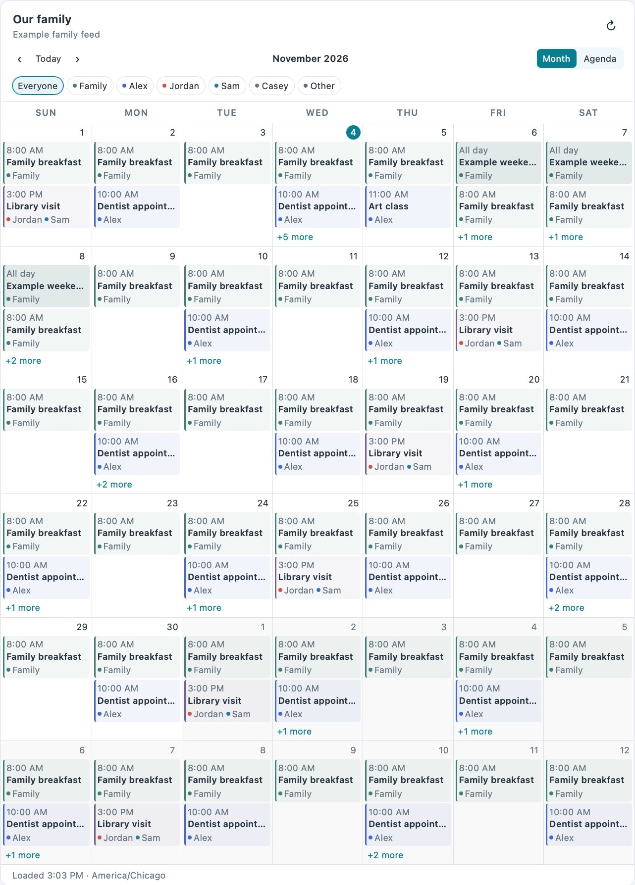
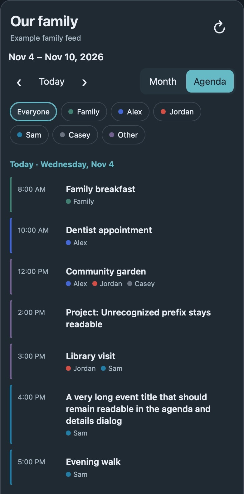

# Community announcement draft

Status: draft only. Replace the repository/release placeholders, confirm installation results, and review screenshots before posting. This file is not evidence of a public announcement.

Suggested forum category: Home Assistant Community → Share your Projects → [Dashboards & Frontend](https://community.home-assistant.io/c/projects/frontend/34).

Suggested title: **Cozi Family Calendar Card: one family feed with attendee colors and shared events**

---

I built an independent Home Assistant dashboard card for Cozi's combined family feed. The goal is a readable family calendar where a shared appointment appears once, with colored labels for everyone involved.

It includes:

- Month and agenda views, including a narrow-screen agenda.
- Configurable names, aliases, and colors.
- Person filters that retain shared and family-wide appointments.
- Cleaned attendee prefixes and an event-details dialog.
- A visual editor and YAML options.

The card reads an existing HA calendar entity. Add Cozi's **All** shared calendar through HA's Remote Calendar integration, then choose that entity and configure your members. It does not ask for a Cozi login, edit appointments, send telemetry, or contact Cozi directly.

This is an original MIT-licensed community project, unaffiliated with Cozi or Home Assistant. The first release is a beta, and feedback on different feed formats, screen sizes, and time zones would be useful.

**Repository:** https://github.com/jaraggie/cozi-calendar-card

**Installation:** [README](https://github.com/jaraggie/cozi-calendar-card#install). HACS installation uses a custom Dashboard repository; it is not yet in the default catalog. PUBLISHER: confirm the installation result before posting.

Please report bugs in the repository's Issues tab with HA/card versions and a fictional example that reproduces the issue. Keep calendar subscription URLs, tokens, and private event details out of posts and issue attachments.
